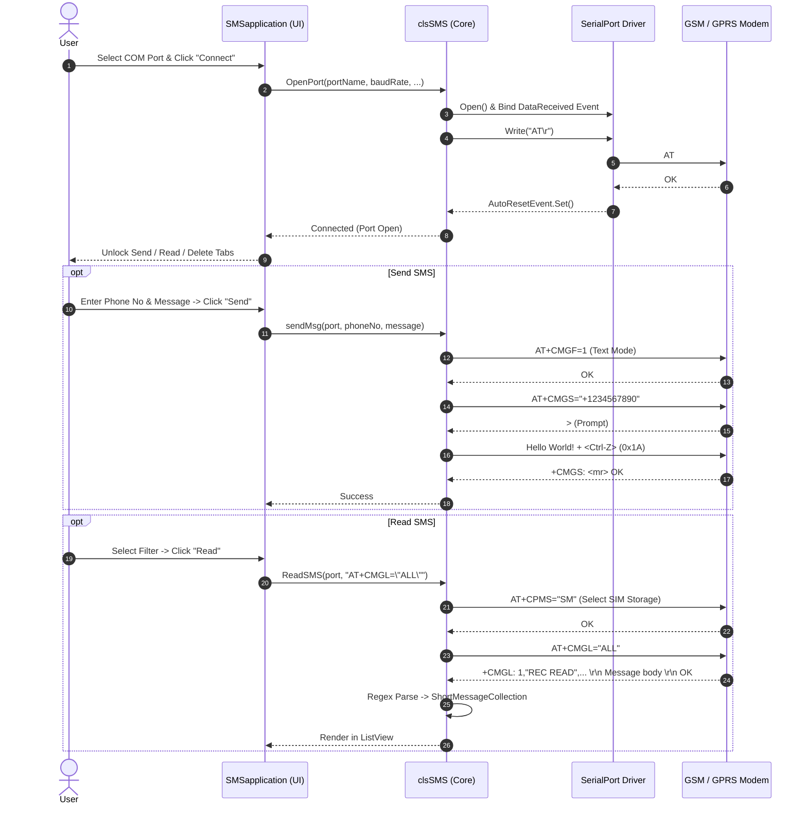

# 📱 SMSSendExample — GSM / SMS Modem Application

[](#)
[](#)
[](#)
[](#)
[](#)

A robust **C# Windows Forms** desktop application for sending, reading, managing, and deleting SMS messages directly through **GSM/GPRS modems**, cellular terminals, or mobile phones connected via **Serial (COM / RS-232 / USB-to-UART)** interfaces using standard **Hayes AT commands** (3GPP / GSM 07.05 & 07.07).

---

## 📑 Table of Contents

- [Overview](#-overview)
- [Key Features](#-key-features)
- [System Architecture](#-system-architecture)
- [Supported AT Commands](#-supported-at-commands)
- [Hardware & Modem Compatibility](#-hardware--modem-compatibility)
- [Project Structure](#-project-structure)
- [Getting Started](#-getting-started)
  - [Prerequisites](#prerequisites)
  - [Build and Run](#build-and-run)
- [User Guide](#-user-guide)
  - [1. Port Configuration & Connection](#1-port-configuration--connection)
  - [2. Sending an SMS](#2-sending-an-sms)
  - [3. Reading Messages](#3-reading-messages)
  - [4. Deleting Messages](#4-deleting-messages)
- [Troubleshooting & FAQs](#-troubleshooting--faqs)
- [Credits & Attribution](#-credits--attribution)

---

## 🌟 Overview

Before cloud SMS gateways (Twilio, AWS SNS, etc.) became ubiquitous, embedded telematics, industrial alert systems, and automated dispatchers communicated over GSM modems. **SMSSendExample** provides a complete reference implementation demonstrating how to interact directly with cellular hardware over serial interfaces without third-party proprietary drivers or paid APIs.

Whether you are working on an IoT gateway, an SMS notification beacon, or learning how serial communication and AT modems work under the hood, this codebase provides clean, practical examples of:
- Serial port lifecycle management with `System.IO.Ports.SerialPort`.
- Thread synchronization via `AutoResetEvent` for asynchronous serial response reading.
- Regular expression parsing of GSM PDU / text responses into strongly-typed objects.

---

## ✨ Key Features

| Feature | Description |
| :--- | :--- |
| **🔌 Auto Port Discovery** | Automatically scans and populates all active hardware and virtual COM ports (`SerialPort.GetPortNames()`). |
| **⚙️ Configurable Serial Parameters** | Full control over Baud Rate (e.g., 9600, 19200, 115200), Data Bits, Parity, Stop Bits, and timeouts. |
| **📤 SMS Dispatching** | Sends outgoing text messages directly via `AT+CMGS` with support for ASCII/GSM character sets. |
| **📥 Message Ingestion & Filtering** | Read SMS directly from SIM storage (`SM`) with status filters: **All**, **Unread**, **Sent**, or **Unsent**. |
| **🧹 Regex Response Parsing** | Automatically extracts Index, Sender, Timestamp, and Message Body into a clean `ListView`. |
| **🗑️ SIM Memory Maintenance** | Bulk or single-message deletion from SIM card memory via `AT+CMGD`. |
| **📊 Real-Time Status & Diagnostics** | Status strip notifications and integrated error logging for debugging modem responses. |

---

## 🏗️ System Architecture

The following sequence diagram illustrates the communication flow between the Windows Forms interface, the internal `clsSMS` controller, and the physical GSM modem over the COM port:



---

## 📡 Supported AT Commands

The application communicates with the cellular modem using standard Hayes GSM commands:

| Command | Function / Purpose | Expected Modem Response |
| :--- | :--- | :--- |
| `AT` | Attention test command to check if modem is responsive | `OK` |
| `AT+CPIN="####"` | Enters SIM PIN code if security lock is active | `OK` or `+CME ERROR` |
| `AT+CMGF=1` | Switches SMS operation mode to **Text Mode** (0 = PDU mode) | `OK` |
| `AT+CSCS="PCCP437"` | Sets the character set encoding for message transfer | `OK` |
| `AT+CPMS="SM"` | Selects preferred SMS storage area (`SM` = SIM card storage) | `+CPMS: <used>,<total>...` |
| `AT+CPMS?` | Queries current message storage capacity and utilized slots | `+CPMS: "SM",X,Y,...` |
| `AT+CMGS="<phone>"` | Initiates SMS dispatch. Waits for `>` prompt, then accepts text + `^Z` (`0x1A`) | `+CMGS: <index>` / `OK` |
| `AT+CMGL="ALL"` | Lists messages stored in memory based on filter | `+CMGL: ...` |
| `AT+CMGD=<index>,<flag>`| Deletes message(s) from selected memory storage | `OK` |

---

## 📟 Hardware & Modem Compatibility

This application is compatible with any GSM / GPRS / 3G / 4G LTE device exposing a serial interface or virtual COM port that supports text-mode SMS:

- **Dedicated GSM Modems:** Wavecom Fastrack, Sierra Wireless AirLink, SIMCom (SIM800 / SIM900 series via FTDI/USB-to-UART), Quectel (M95, EC25), Telit.
- **USB 3G/4G Dongles:** Huawei (E1550, E173, E3531, etc.), ZTE, Sierra Wireless (exposing their NMEA / PC UI Interface ports).
- **Mobile Phones:** Classic Sony Ericsson, Nokia, Motorola, or Siemens devices connected via USB data cable or Bluetooth Serial Port Profile (SPP).
- **Development Boards:** Arduino / Raspberry Pi GSM shields hooked to PC COM ports.

---

## 📂 Project Structure

```text
SMSSendExample/
├── SMSapplication.sln              # Visual Studio Solution File
└── SMSapplication/                 # Main Application Project
    ├── Classes/                    # Core GSM Communication Logic
    │   ├── clsSMS.cs               # AT command parser, serial port handler & SMS controller
    │   ├── ShortMessage.cs         # Data model representing an individual SMS entity
    │   └── ShortMessageCollection.cs # Strongly-typed list collection (List<ShortMessage>)
    ├── Properties/
    │   ├── AssemblyInfo.cs         # Assembly metadata and versioning
    │   ├── Resources.resx          # UI resource string & asset table
    │   └── Settings.settings       # User application settings
    ├── Program.cs                  # Main WinForms entry point
    ├── SMSapplication.cs           # Main Form event handlers and UI logic
    ├── SMSapplication.Designer.cs  # WinForms component and designer layout definitions
    ├── SMSapplication.resx         # Form resource XML
    └── SMSapplication.csproj       # C# Project File (.NET Framework)
```

### Key Classes Explained

- **[`SMSapplication.cs`](file:///Users/alekseiprokopov/Projects/SMSSendExample/SMSapplication/SMSapplication.cs)**: Main UI window handling user events, combo-box population, dynamic tab presentation, and thread-safe UI updates.
- **[`clsSMS.cs`](file:///Users/alekseiprokopov/Projects/SMSSendExample/SMSapplication/Classes/clsSMS.cs)**: The communication engine. Handles port opening/closing, AT command execution, response buffering, timeout management, regex parsing, and error capturing.
- **[`ShortMessage.cs`](file:///Users/alekseiprokopov/Projects/SMSSendExample/SMSapplication/Classes/ShortMessage.cs)**: Clean POCO model with `Index`, `Status`, `Sender`, `Alphabet`, `Sent`, and `Message` properties.

---

## 🚀 Getting Started

### Prerequisites

- **Operating System:** Windows 7 / 8 / 10 / 11 (or Wine on Linux / macOS for testing).
- **Development Environment:**
  - Visual Studio 2015, 2017, 2019, or 2022.
  - Or Visual Studio Community / SharpDevelop / Rider.
- **Runtime:** .NET Framework 2.0 or newer (built into Windows).
- **Hardware:** A GSM modem or USB cellular dongle with an active SIM card inserted.

### Build and Run

#### Option 1: Visual Studio (GUI)
1. Double-click `SMSapplication.sln` to open the solution in Visual Studio.
2. Select `Release` or `Debug` with `Any CPU` target.
3. Press **F5** or click **Start** to build and run the application.

#### Option 2: Command Line (MSBuild)
Open the **Developer Command Prompt for Visual Studio** and run:

```bash
# Clone the repository
git clone https://github.com/roboter/SMSSendExample.git
cd SMSSendExample

# Build the project
msbuild SMSapplication.sln /p:Configuration=Release

# Launch the executable
SMSapplication\bin\Release\SMSapplication.exe
```

---

## 📖 User Guide

### 1. Port Configuration & Connection
1. Connect your GSM modem to an available USB or serial port on your PC.
2. Launch `SMSapplication.exe`.
3. Under the **Port Settings** tab:
   - Select your modem's **COM Port** from the dropdown list.
   - Choose the appropriate **Baud Rate** (typically `9600` or `115200`).
   - Default timeout values (`300 ms` read / `300 ms` write) work for most modems.
4. Click **Connect**.
5. Once verified, the status bar will display `Modem is connected at PORT COMx`, and the **Send**, **Read**, and **Delete** tabs will become active.

### 2. Sending an SMS
1. Switch to the **Send SMS** tab.
2. Enter the destination phone number in the **SIM No** field (international format recommended, e.g. `+1234567890`).
3. Type your text in the **Message** text box.
4. Click **Send**. The application will send the message using `AT+CMGS` and notify you upon receipt of the modem's acknowledgement.

### 3. Reading Messages
1. Switch to the **Read SMS** tab.
2. Choose your filter option:
   - 🔘 **All Messages** (`AT+CMGL="ALL"`)
   - 🔘 **Unread Messages** (`AT+CMGL="REC UNREAD"`)
   - 🔘 **Stored Sent Messages** (`AT+CMGL="STO SENT"`)
   - 🔘 **Stored Unsent Messages** (`AT+CMGL="STO UNSENT"`)
3. Click **Read**. The messages stored on the SIM card will be populated in the list view showing Index, Date Sent, Sender, and Message text.

### 4. Deleting Messages
1. Switch to the **Delete SMS** tab.
2. Select whether to delete **All Messages** or only **Read Messages**.
3. Click **Delete** and confirm the prompt to free up SIM storage space.

---

## 🔍 Troubleshooting & FAQs

<details>
<summary><b>❓ Port is not listed in the Port Name dropdown</b></summary>

- Ensure your modem's USB-to-UART or cellular driver is properly installed in Windows Device Manager.
- Look under **Ports (COM & LPT)** or **Modems** in Device Manager to find the assigned COM port number.
- Restart the application after plugging in the USB device so `SerialPort.GetPortNames()` detects the new hardware.
</details>

<details>
<summary><b>❓ "No phone connected" or timeout error upon connecting</b></summary>

- Check that another program (e.g. Putty, hyperterminal, manufacturer connection manager) is not currently holding the COM port open.
- Try different baud rates: while older modems default to `9600`, newer 3G/4G USB dongles often require `115200` or `57600`.
</details>

<details>
<summary><b>❓ "Failed to set message format" (AT+CMGF=1 error)</b></summary>

- Some older or CDMA-only modems do not support SMS **Text Mode** (`AT+CMGF=1`) and only support **PDU Mode** (`AT+CMGF=0`).
- Ensure your device is a standard GSM/UMTS/LTE device supporting 3GPP AT commands.
</details>

<details>
<summary><b>❓ SIM is locked with PIN</b></summary>

- If your SIM card requires a PIN code, verify whether `AT+CPIN="<your-pin>"` is sent or disable the PIN lock using a mobile phone prior to inserting it into the modem.
</details>

---

## 👥 Credits & Attribution

- **Original Author:** Syeda Anila Nusrat (August 2009)
- **Repository Maintainer:** [roboter](https://github.com/roboter)

---

<p align="center">
  <i>Developed with ❤️ for embedded systems, serial communication, and GSM hardware integration.</i>
</p>
